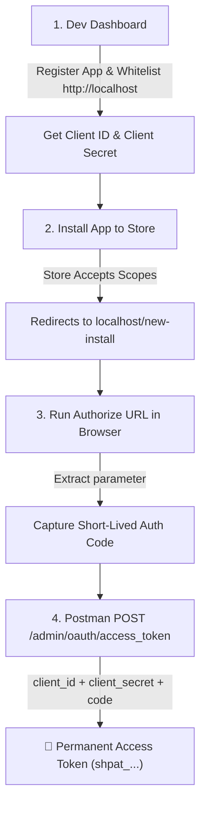

# Shopify Admin API Access Token (2026 Manual OAuth & Dev Dashboard Method)

> **Source Video:** [Coding with Jan - Shopify Developer: "Shopify Access Token 2026 - How to get an Admin API Access Token"](https://youtu.be/8dymQjcylv8)  
> **Word Document (.docx):** [SHOPIFY_ACCESS_TOKEN_SETUP_GUIDE.docx](file:///c:/Projects/01_Ecommerce_and_Themes/DRUNKEN-GLASS-Developer-Handover/SHOPIFY_ACCESS_TOKEN_SETUP_GUIDE.docx)  
> **Downloads Folder Copy:** `C:\Users\hawk1\Downloads\SHOPIFY_ACCESS_TOKEN_SETUP_GUIDE.docx`

---

## 💡 Why This Exact Process is Required
Shopify **no longer displays permanent API access tokens directly on their Developer Dashboard or Admin Custom App page**. When connecting third-party software, ERP systems, or custom backend services that require a Shopify Admin API access token, you must manually complete the **OAuth 2.0 Authorization Code Grant flow**:
1. Register your app in the **Shopify Dev Dashboard**.
2. Install the app onto your store to grant required scopes.
3. Manually construct and trigger the **OAuth Authorization URL** to obtain a temporary **Authorization Code**.
4. Make a **POST request in Postman** to exchange that authorization code for the permanent **Admin API Access Token** (`shpat_...`).

---

## 🔑 Jan's Security Analogy (Understanding the Credentials)

| Credential | Jan's Analogy | Description & Security Role |
| :--- | :--- | :--- |
| **Client ID** | **Passport / Username** | Identifies your app to Shopify (publicly visible in URLs). |
| **Client Secret** | **Private Password** | Proves that you are the true owner of the app. Never expose publicly. |
| **Authorization Code** | **Temporary Ticket** | Short-lived token (~2 minutes) returned in the redirect URL after merchant approval. |
| **Access Token** | **Master Key (`shpat_...`)** | The permanent bearer token used to authenticate all REST/GraphQL API calls. |

---

## 📋 Exact Step-by-Step Walkthrough

### Phase 1: Register New App in Shopify Dev Dashboard
1. **Navigate to Dev Dashboard:**
   * Open your Shopify Store Admin area (`https://admin.shopify.com`).
   * Click on your **Profile Icon** (top corner).
   * Click on **Dev Dashboard** (or go directly to [dev.shopify.com](https://dev.shopify.com)).
2. **Create the App Record:**
   * Click the **Create app** button.
   * **App Name:** Enter a descriptive name (e.g., `my-custom-app-123` or your software name).
   * Click **Create**.
3. **Configure App Settings & URLs:**
   * **App URL:** Set to `http://localhost/new-install` *(in production, this is where merchants land for onboarding/welcome emails)*.
   * **Embedded App:** **UNCHECK** this checkbox *(Jan explicitly unchecks it because we only need backend API access, not an embedded iframe inside Shopify admin)*.
   * **API Version:** Leave on the most recent release.
4. **Select Access Scopes (Permissions):**
   * Under **Access Scopes**, select the permissions required (e.g. `write_products`, which automatically includes `read_products`).
   * *Best Practice:* Keep scopes as narrow as possible for maximum security.
   * *Optional Scopes:* Leave blank.
5. **Whitelist Redirect URLs:**
   * Under **Redirect URLs**, enter: `http://localhost`.
   * *Why?* This is a critical security whitelist. Shopify will only trust and redirect to URLs specified here during OAuth.
6. **Release & Note Credentials:**
   * Click **Release / Save** to publish this version.
   * Go to the **Settings** tab of your app.
   * Copy and note your:
     * **Client ID** (e.g. `37549832049...`)
     * **Client Secret** (App private password)

---

### Phase 2: Install App on Your Store & Accept Permissions
1. Go back to **Home** in the Dev Dashboard navigation.
2. Scroll down to the **Installs** section and click **Install the app**.
3. Select your store from the dropdown (e.g., `Coding with Yandev` or your store handle).
4. Shopify opens the standard app installation grant screen:
   ```text
   https://admin.shopify.com/store/{shop}/app/grant?client_id={CLIENT_ID}
   ```
5. Shopify displays the warning: *"This app hasn't been reviewed"* (this is expected for private/unlisted apps) and lists the requested permissions (e.g., *View and edit store data products*).
6. Click the green **Install** button.
7. **What happens next:**  
   The browser redirects to:
   ```text
   http://localhost/new-install?hmac=...&host=...&shop=your-store.myshopify.com&timestamp=...
   ```
   > [!NOTE]
   > The browser will show **"This site can't be reached"** or **"Unable to connect"**. Jan emphasizes that this is **100% normal** because there is no server running locally on your computer. Shopify has successfully recorded the store installation!

---

### Phase 3: Construct OAuth Authorization URL & Extract Auth Code
Now, manually initiate the OAuth authorization flow in your browser.

1. **Construct the URL in Notepad or any text editor:**
   ```text
   https://{shop}.myshopify.com/admin/oauth/authorize?client_id={CLIENT_ID}&redirect_uri=http://localhost
   ```
   * Replace `{shop}` with your store subdomain (e.g., `codingwithyandev`).
   * Replace `{CLIENT_ID}` with your App Client ID from Phase 1.
   * Ensure `redirect_uri=http://localhost` matches what you whitelisted.
   * Remove any line breaks so the URL is on a single continuous line.

   *Example from Jan's video:*
   ```text
   https://codingwithyandev.myshopify.com/admin/oauth/authorize?client_id=37549832049...&redirect_uri=http://localhost
   ```

2. **Execute in Browser:**
   * Paste the constructed URL into the browser where you are logged into your Shopify store and hit **Enter**.
3. **Capture the Redirect URL:**
   * The browser redirects to:
     ```text
     http://localhost/?code=94a5c88b712398fd128a3910c...&hmac=...&host=...&shop=codingwithyandev.myshopify.com&timestamp=...
     ```
   * Again, the page will say *"This site can't be reached"*.
4. **Extract the Authorization Code:**
   * Look closely at the browser address bar.
   * Copy the exact string between `code=` and `&hmac=`.
   * This is your **Authorization Code**.

> [!CAUTION]
> **CRITICAL EXPIRATION WARNING (2-5 MINUTES):**  
> This authorization code is **short-lived**! If you wait too long before running Phase 4, Shopify will reject it with:
> `{"error": "oauth error: invalid request"}`  
> If it expires, **do not panic**: simply re-paste the authorize URL in your browser, hit enter, copy the new code, and proceed immediately to Phase 4.

---

### Phase 4: Exchange Authorization Code for Permanent Access Token in Postman
1. **Open Postman:**
   * Open Postman (Free tier / Web or Desktop).
   * Click **New** -> **HTTP Request**.
2. **Configure Endpoint & Method:**
   * Method: **POST**
   * URL:
     ```text
     https://{shop}.myshopify.com/admin/oauth/access_token
     ```
3. **Enter Parameters (Params / Body):**
   Enter the following 3 key-value parameters:

   | Key | Value | Description |
   | :--- | :--- | :--- |
   | `client_id` | `YOUR_CLIENT_ID` | Your App Client ID from Phase 1 |
   | `client_secret` | `YOUR_CLIENT_SECRET` | Your App Client Secret from Phase 1 |
   | `code` | `AUTHORIZATION_CODE` | The code extracted from the browser in Phase 3 |

4. **Send the Request:**
   * Click the blue **Send** button.
5. **Inspect the Response:**
   Shopify responds with HTTP 200 OK and the JSON payload:
   ```json
   {
     "access_token": "shpat_xxxxxxxxxxxxxxxxxxxxxxxxxxxxxxxx",
     "scope": "write_products"
   }
   ```
6. **Save Your Access Token:**
   * The `access_token` (starting with `shpat_`) is your **permanent Admin API Access Token**.
   * Store it securely in your `.env` or credentials vault.
   * **Never expose this publicly or commit it to GitHub**, as it possesses direct access to your store backend.

---

## 🧪 Phase 5: Verification (Test API Call)

Run a test call using cURL or Postman to confirm the token is working:

```bash
curl -X GET "https://{shop}.myshopify.com/admin/api/2026-01/shop.json" \
  -H "Content-Type: application/json" \
  -H "X-Shopify-Access-Token: shpat_xxxxxxxxxxxxxxxxxxxxxxxxxxxxxxxx"
```

Or GraphQL Admin API:
```bash
curl -X POST "https://{shop}.myshopify.com/admin/api/2026-01/graphql.json" \
  -H "Content-Type: application/json" \
  -H "X-Shopify-Access-Token: shpat_xxxxxxxxxxxxxxxxxxxxxxxxxxxxxxxx" \
  -d '{"query": "{ shop { name email myshopifyDomain } }"}'
```

---

## 🛠️ Common Errors & Solutions (From Jan's Video)

| Error Response | Cause | Exact Fix |
| :--- | :--- | :--- |
| `{"error": "oauth error: invalid request"}` | The authorization code expired (they only last 2-5 minutes). | Re-paste your Phase 3 URL into the browser, press Enter, copy the fresh `code`, update Postman, and click Send immediately. |
| `{"error": "redirect_uri is not whitelisted"}` | Mismatch between URL in Phase 3 and Dev Dashboard settings. | Ensure `http://localhost` is added to **Redirect URLs** in your App configuration on Dev Dashboard. |
| `{"error": "invalid_client"}` | Incorrect Client ID or Client Secret. | Re-copy `client_id` and `client_secret` from the **Settings** tab in Dev Dashboard. |

---

## 🏁 Summary Flow


